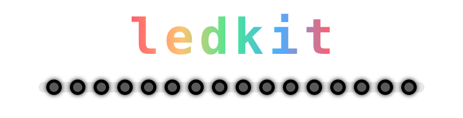

<div align="center">



### Addressable LEDs in Rust that just work.

NeoPixels, DotStars, strips, rings and matrices. Name your chip, pick your board,
and ledkit handles the timing, color order, brightness and power.

[](https://github.com/jrowe88/ledkit/actions/workflows/ci.yml)


**[Get started](#get-started)** · **[Examples](#pick-your-board)** · **[Supported LEDs](crates/ledkit-core/README.md#which-chip-type-do-i-use)** · **[Roadmap](docs/superpowers/plans/2026-10-25-ledkit-roadmap.md)**

</div>

## Light up in a dozen lines

<table>
<tr>
<td width="56%">

```rust
use ledkit_core::prelude::*;
use ledkit_spi::{buffer_len, ClocklessSpi};

const LEDS: usize = 30;
const SPI_HZ: u32 = 3_200_000;

// `spi` is your board's SPI bus, set up as usual.
let output = ClocklessSpi::new(spi, SPI_HZ,
    [0u8; buffer_len::<Ws2812b>(LEDS, SPI_HZ)])?;
let mut strip = Strip::<Ws2812b, LEDS, _>::new(output);

strip.set_brightness(0.3);            // looks 30% as bright
strip.set_power_limit(Milliamps(1500)); // caps the LEDs' estimated current, not the board's
strip.fill(Color::BLUE);
strip.show()?;
```

</td>
<td>


</td>
</tr>
</table>

## Why ledkit

<table>
<tr>
<td width="33%" valign="top">

**Say the chip, not the timings**<br>
Write `Ws2812b` or `Apa102`. ledkit knows each chip's pulse timing and
color order, and checks them against the datasheet.

</td>
<td width="33%" valign="top">

**Brightness that looks right**<br>
`0.5` looks half as bright. Dithering smooths dim fades, and colors go
out exactly as you set them.

</td>
<td width="33%" valign="top">

**Won't cook your USB port**<br>
Set a milliamp limit, and ledkit dims the whole strip just enough to
stay under it.

</td>
</tr>
<tr>
<td valign="top">

**Mistakes caught at build time**<br>
A DotStar on a NeoPixel driver, or an SPI clock your LEDs can't use,
fails to compile with a clear message.

</td>
<td valign="top">

**One API, many boards**<br>
ESP32 (esp-hal or ESP-IDF), Raspberry Pi, Teensy 4, or anything with an
`embedded-hal` SPI bus or an `embedded-io` serial port.

</td>
<td valign="top">

**Plays well with others**<br>
Works with the `smart-leds` ecosystem, needs no heap, and supports
blocking or async (Embassy).

</td>
</tr>
</table>

## Pick your board

Each example is a complete project, with the settings you'd change
(`LED_COUNT`, the pin, the LED type, brightness) at the top of `main.rs`
and wiring, setup and troubleshooting in its README.

| Board | Crate | Example | Tested |
|---|---|---|---|
| ESP32-C6 with esp-hal (`no_std`) | `ledkit-esp` | [esp32c6-rmt](examples/esp32c6-rmt) | ✅ on hardware |
| ESP32-C6 with ESP-IDF (`std`, Wi-Fi) | `ledkit-esp-idf` | [esp32c6-esp-idf](examples/esp32c6-esp-idf) | ✅ on hardware |
| Any board with an SPI bus | `ledkit-spi` | [esp32c6-spi](examples/esp32c6-spi) | ✅ on hardware |
| Raspberry Pi (Linux) | `ledkit-spi` | [linux-spidev](examples/linux-spidev) | ✅ on hardware |
| Teensy 4 | `ledkit-spi` | [teensy4-spi](examples/teensy4-spi) | ✅ on hardware |
| LED matrix on the ESP32-C6 | `ledkit-layout` + `ledkit-esp` | [esp32c6-matrix](examples/esp32c6-matrix) | ✅ on hardware |
| Animations on a matrix or strip, ESP32-C6 | `ledkit-anim` + `ledkit-esp` | [esp32c6-anim](examples/esp32c6-anim) | ✅ on hardware (8x8 matrix and 100-LED strip) |
| Every animation on a matrix or strip, Teensy 4 | `ledkit-anim` + `ledkit-spi` | [teensy4-anim](examples/teensy4-anim) | ✅ on hardware (8x8 matrix and 100-LED strip) |
| Animations in your terminal (no LEDs) | `ledkit-anim` | [anim-preview](examples/anim-preview) | ✅ |
| DotStar HD vs plain dimming on the ESP32-C6 | `ledkit-core` | [esp32c6-dotstar-hd](examples/esp32c6-dotstar-hd) | ✅ on hardware |
| NeoPixels from a serial port, ESP32-C6 | `ledkit-uart` | [esp32c6-uart](examples/esp32c6-uart) | ✅ on hardware |
| NeoPixels from a serial port, Teensy 4 (with DMA) | `ledkit-uart` | [teensy4-uart](examples/teensy4-uart) | ✅ on hardware |
| Raspberry Pi Pico | `ledkit-rp` | | 🔜 coming soon |

## Get started

1. **Find your LED type.** Look for the name printed on the product or in its
   listing, then find it in the
   ["which chip type do I use?"](crates/ledkit-core/README.md#which-chip-type-do-i-use) table.
2. **Copy the example for your board** from the table above, and change
   `LED_COUNT`, the pin and the LED type at the top of `main.rs`.
3. **Run it** with `cargo run --release`. If the colors are wrong or nothing
   lights up, the example's README has a troubleshooting section.

ledkit isn't on crates.io yet, so for now depend on it from git or a local
checkout, as the examples do.

## Gallery

<table>
<tr>
<td width="33%"></td>
<td width="33%"></td>
<td width="33%"></td>
</tr>
</table>

## The crates

| Crate | What it does | Status |
|---|---|---|
| `ledkit-color` | Colors, hues, gradients, gamma | ✅ available |
| `ledkit-core` | The LED chip catalogue, the `Strip` buffer, brightness, dithering and power limiting | ✅ available |
| `ledkit-spi` | Drives LEDs from any `embedded-hal` SPI bus, blocking or async | ✅ available |
| `ledkit-uart` | Drives NeoPixels from any `embedded-io` serial port with an inverted output, blocking or async (DMA) | ✅ available |
| `ledkit-esp` | ESP32 RMT driver for esp-hal (`no_std`, blocking or async) | ✅ available |
| `ledkit-esp-idf` | ESP32 RMT driver for ESP-IDF (`std`) | ✅ available |
| `ledkit-layout` | Segments, matrices, text and shapes | ✅ available |
| `ledkit-anim` | Effects (rainbow, comet, flames, swirl, …) and ways to combine them | ✅ available |
| `ledkit-rp` | Raspberry Pi Pico (RP2040/RP2350) PIO driver | 🔜 planned |
| `ledkit` | One crate to add, with everything re-exported | 🔜 planned |
| `ledkit-sim` | A desktop simulator, to try effects without hardware | 🔜 planned |

"Available" means it works and is tested, but isn't published to crates.io yet.

## Status and roadmap

ledkit is young. The core, the SPI driver, both ESP32 drivers and the matrix
layer (`ledkit-layout`: matrices, text and shapes) work and are tested on real
hardware. Effects (`ledkit-anim`) are tested on the host and on an 8x8 matrix.
Text support (fonts, digits in several sizes, scrolling text) is being designed: try
the fonts in the [text preview](https://jrowe88.github.io/ledkit/text-preview/).
Next up: the Raspberry Pi Pico and the `ledkit` facade. See the [roadmap](docs/superpowers/plans/2026-10-25-ledkit-roadmap.md)
for the details.

Want to help? [CONTRIBUTING.md](CONTRIBUTING.md) has short guides to adding an
LED type, a new board, a panel preset or an effect.

## License

Licensed under either of the [Apache License, Version 2.0](LICENSE-APACHE) or
the [MIT license](LICENSE-MIT), at your option. See [NOTICE](NOTICE) for
attributions.
